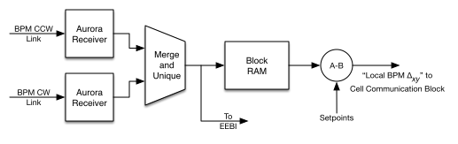
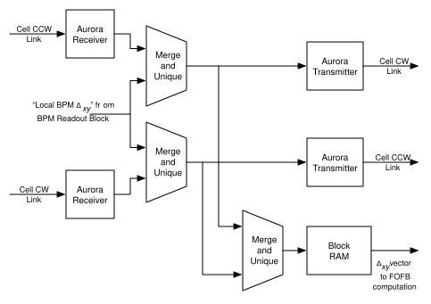
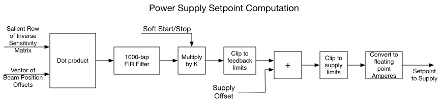

# Cell Controller — Firmware Notes

> [!NOTE]
> **LBNL-Cell-controller docs:** [Overview](README.md) · [Firmware Notes](FirmwareNotes.md) · [Hardware Notes](HardwareNotes.md) · [Configuration](CellControllerConfiguration.md) 
> **Related projects:** [EPICS support ↗](https://git.als.lbl.gov/accelerator-controls/epics/iocs/sioccellcontroller/-/blob/HEAD/documentation/EPICSnotes.md) · [cell-comm ↗](https://github.com/BerkeleyLab/cell-comm)

## Contents

- [Introduction](#introduction)
- [Local BPM Readout](#local-bpm-readout)
- [Cell Communication](#cell-communication)
- [Corrector Power Supply Setpoint Computation](#corrector-power-supply-setpoint-computation)

---

## Introduction

BPMs talk to cell controllers, and cell controllers talk to each other, over **Aurora** fiber links. Two gateware variants are built from this repository:

| Build (`APP`) | Link protocol |
|---|---|
| `cctrl_aurora_8b10b` (default) | Aurora 8B/10B, 3.125 Gb/s |
| `cctrl_aurora_64b66b` | Aurora 64B/66B |

The modules that replicate BPM data between cell controllers come from the [cell-comm](https://github.com/BerkeleyLab/cell-comm) submodule (`gateware/submodules/cell-comm`), which other projects also reuse.

The firmware that replicates the values from all BPMs among all cell controllers is based on **Merge and Unique** blocks, which accept two streams and merge them into one:

- Each block holds a *received packet* bitmap and a *received packet* counter.
- Each packet carries the node number of the BPM or cell controller that originated it.
- A packet is forwarded only if its bit in the bitmap is clear. Forwarding sets the bit and increments the counter.

At the fast acquisition (FA) rate, every cell controller clears all bitmaps and counters. The BPM readout block then waits for values from the local BPMs. Once they have all arrived, a packet containing all the deviations from the desired orbit is sent to the cell controller communication block.

The cell controller communication block accepts packets from the incoming Aurora links and the local stream, and forwards them to the opposite outgoing Aurora links. Outgoing packets for each link are also merged and stored in a local dual-port RAM. When the number of packets forwarded to the RAM reaches the number of cell controllers in the system, its contents are made available to the fast orbit feedback processing firmware.

---

## Local BPM Readout

The Aurora receiver blocks convert incoming packets from the clockwise (CW) and counterclockwise (CCW) links to AXI streams. The two streams are merged into one, with data from any given BPM appearing only once. The values are stored in block RAM until values from all locally connected BPMs have arrived. The [orbit setpoints](https://git.als.lbl.gov/accelerator-controls/epics/iocs/sioccellcontroller/-/blob/HEAD/documentation/EPICSnotes.md#bpm-setpoints) are then subtracted and the results sent as an AXI stream to the cell communication block.

---

## Cell Communication

The Aurora receiver blocks convert incoming packets from the CW and CCW links to AXI streams. *Clockwise* and *counterclockwise* refer to the physical fiber links; data flow in both directions on both links.

- Each incoming stream is merged with the stream of local BPM offsets, and a packet is forwarded only if it is from a cell controller not already seen.
- CCW link + local stream → Aurora packets → **CW** cell link.
- CW link + local stream → Aurora packets → **CCW** cell link.
- Both merged streams are combined and stored in block RAM.

When values from all cell controllers have been received, the fast orbit feedback block uses this RAM to compute the settings for the power supplies this cell controller drives.

The cell links also carry fast machine protection (FMPS) data; the `fmps` [console command](CellControllerConfiguration.md#console-commands) shows the received values.

---

## Corrector Power Supply Setpoint Computation

Once the cell controller has its local beam positions, has computed their deviations from the desired orbit, and has received the deviations from all other cell controllers, it computes the fast orbit feedback corrector currents:

| Property | Value |
|---|---|
| Dot product resolution | 2−10 mA (976.5625 nA) per count. All later stages use this representation until the conversion to floating-point amperes. |
| Dot product width | 26 bits — range about ±32.7 A |
| Multiplier product and later stages | 28 bits — range about ±131 A |
| Soft start/stop | Ramps the FOFB gain between zero and the set value over about 100 ms |

The soft-start gain is held at 0 until **every** cell controller reports its local FOFB enable as asserted. A cell controller's local FOFB enable follows its [`FOFBenable`](https://git.als.lbl.gov/accelerator-controls/epics/iocs/sioccellcontroller/-/blob/HEAD/documentation/EPICSnotes.md#control-records) record.

> [!NOTE]
> The gateware has no beam current input. The IOC's [beam current watchdog](https://git.als.lbl.gov/accelerator-controls/epics/iocs/sioccellcontroller/-/blob/HEAD/documentation/EPICSnotes.md#beam-current-watchdog) clears `FOFBenable` instead when the current is low.

### Inverse sensitivity matrix multiplication

First, raw corrector currents are obtained by multiplying the vector of beam position deviations by the [inverse sensitivity matrix](https://git.als.lbl.gov/accelerator-controls/epics/iocs/sioccellcontroller/-/blob/HEAD/documentation/EPICSnotes.md#fast-orbit-feedback-matrix-rows):

$$
\begin{bmatrix}
c_{x_{0,0}} & \cdots & c_{x_{0,511}} & c_{y_{0,0}} & \cdots & c_{y_{0,511}} \\
c_{x_{1,0}} & \cdots & c_{x_{1,511}} & c_{y_{1,0}} & \cdots & c_{y_{1,511}} \\
\vdots & \ddots & \vdots & \vdots & \ddots & \vdots \\
c_{x_{N,0}} & \cdots & c_{x_{N,511}} & c_{y_{N,0}} & \cdots & c_{y_{N,511}}
\end{bmatrix}
\cdot
\begin{bmatrix}
\Delta_{x_0} \\ \vdots \\ \Delta_{x_{511}} \\ \Delta_{y_0} \\ \vdots \\ \Delta_{y_{511}}
\end{bmatrix}
=
\begin{bmatrix}
S_0 \\ S_1 \\ \vdots \\ S_N
\end{bmatrix}
$$

- The multiplication takes about **5.2 µs** regardless of the number of rows.
- All 1024 elements of the vector and of each matrix row always take part. Missing BPMs are handled by setting the corresponding matrix elements to zero.
- Matrix elements are 32-bit two's complement integers scaled from [−1, 1) A/µm, so the LSB is 2−31 A/µm.
- Position deviations are in nm, so each product term has a resolution of 2−31 mA.
- The 16 least significant bits are discarded before the dot product accumulators, and the 5 least significant bits of the accumulators are discarded, leaving a 32-bit product with 2−10 mA per count.

### Filtering

Each element of the raw corrector current vector passes through a **1000-tap FIR filter** with its own set of [coefficients](https://git.als.lbl.gov/accelerator-controls/epics/iocs/sioccellcontroller/-/blob/HEAD/documentation/EPICSnotes.md#fast-orbit-feedback-filter-coefficients) in [−1, 1). The filtering takes about 5.2 µs regardless of the number of correctors. If a filter's coefficients sum to 1.0, it has unity DC gain and its output keeps the 2−10 mA per count resolution.

### Gain

Each filter output is multiplied by a per-supply [gain factor](https://git.als.lbl.gov/accelerator-controls/epics/iocs/sioccellcontroller/-/blob/HEAD/documentation/EPICSnotes.md#gains-and-limits) in [0, 16).

### Fast feedback clipping

The scaled filter output may be [clipped](https://git.als.lbl.gov/accelerator-controls/epics/iocs/sioccellcontroller/-/blob/HEAD/documentation/EPICSnotes.md#gains-and-limits) (`ffbLimits`) before the slow orbit feedback offset is added.

### Slow orbit feedback offset

The scaled and clipped filter outputs are added to the [offsets](https://git.als.lbl.gov/accelerator-controls/epics/iocs/sioccellcontroller/-/blob/HEAD/documentation/EPICSnotes.md#corrector-power-supply-offsets) set by the slow orbit feedback system.

### Clipping

The sum may be [clipped](https://git.als.lbl.gov/accelerator-controls/epics/iocs/sioccellcontroller/-/blob/HEAD/documentation/EPICSnotes.md#gains-and-limits) (`psLimits`) before being sent to the supplies.
